# 🚌 Wessal | وصّال – Smart University Transportation for Umm Al-Qura University

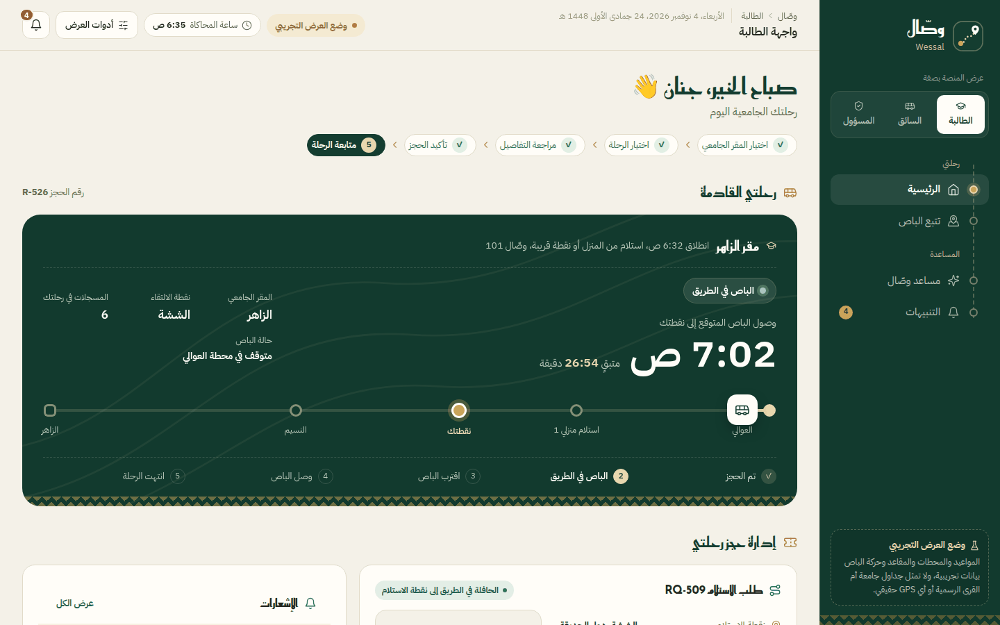

**باصك أقرب، ووقتك أثمن.** — *Your bus is closer, your time is more valuable.*

An Arabic-first, AI-assisted transportation platform that picks female students up from home or a nearby pickup point, groups compatible trips, assigns vehicles from a dedicated fleet, and delivers students to their exact campus gate at Umm Al-Qura University.

> 🧪 **Prototype status:** Wessal is an interactive prototype built for the *Qimma Camp – Emerging Technologies Track* (Tuwaiq Club & Tuwaiq Academy, Umm Al-Qura University). All trips, vehicles, maps and GPS positions are **simulated demo data**. No real vehicle is dispatched.

---

## 🌿 Overview

Getting to university every day is harder than it should be: students wait without knowing when the bus will arrive, fixed bus lines ignore where they live and when their first lecture starts, and transport management has little data to plan capacity across UQU's campuses (**Al-Zahir, Al-Abdiyah, Al-Aziziyah, Rea Thakher, Al-Jumum**).

Wessal solves this with three connected experiences:

- 🎓 **Student** — request a ride, choose a private pickup option, track the bus and receive arrival alerts
- 🚐 **Driver** — follow an ordered pickup sequence, confirm boarding, report delays or breakdowns
- 🛡️ **Transport administrator** — review AI dispatch recommendations, manage the fleet and destinations, forecast demand and test scenarios

Every consequential decision made by the AI agent requires **administrator approval** before it is executed.

---

# ✨ Application Screenshots

## 🏠 Student Home

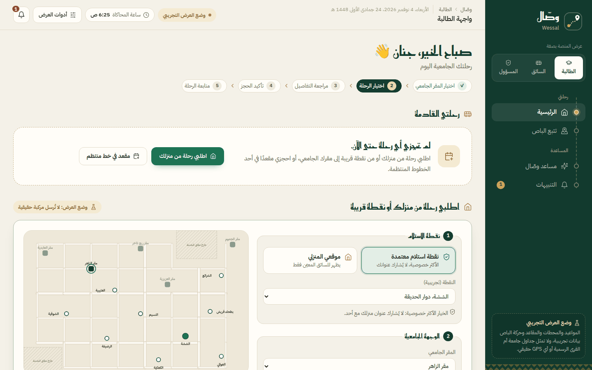

---

## 📍 Ride Request (home or nearby pickup point)

Students choose a designated pickup point (most private) or pin their home location, then select campus → college → building → approved gate and their required arrival time.

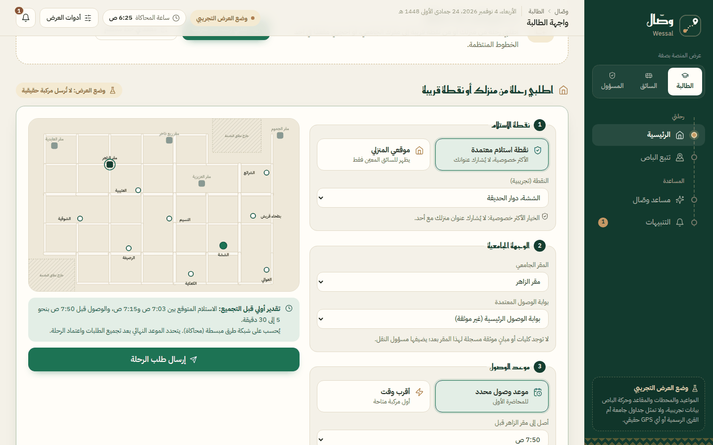

---

## 🧭 Request Status Timeline

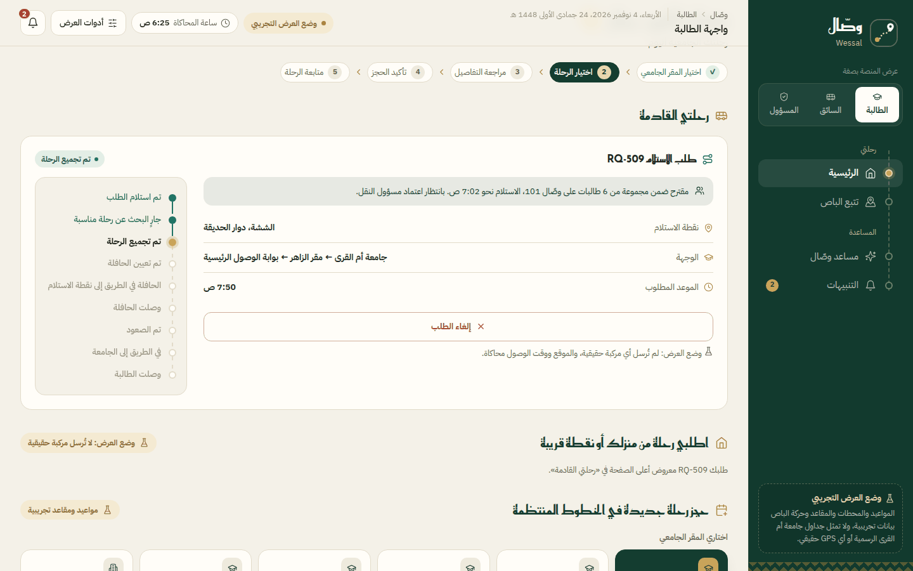

---

## 🚌 Live Trip Progress


---

## 🗺️ Bus Tracking (simulated)

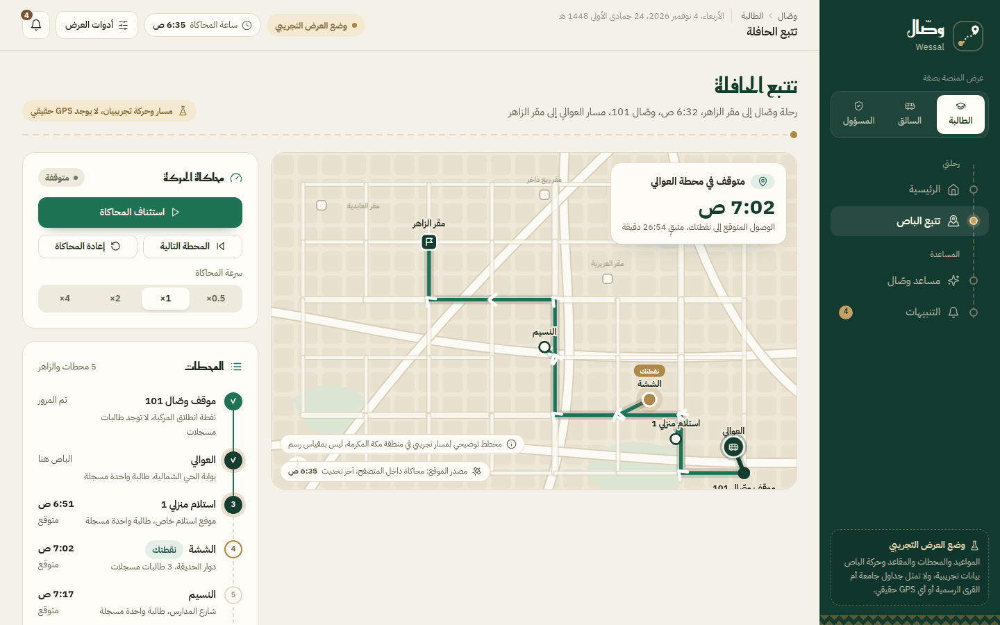

---

## 🚐 Driver Dashboard

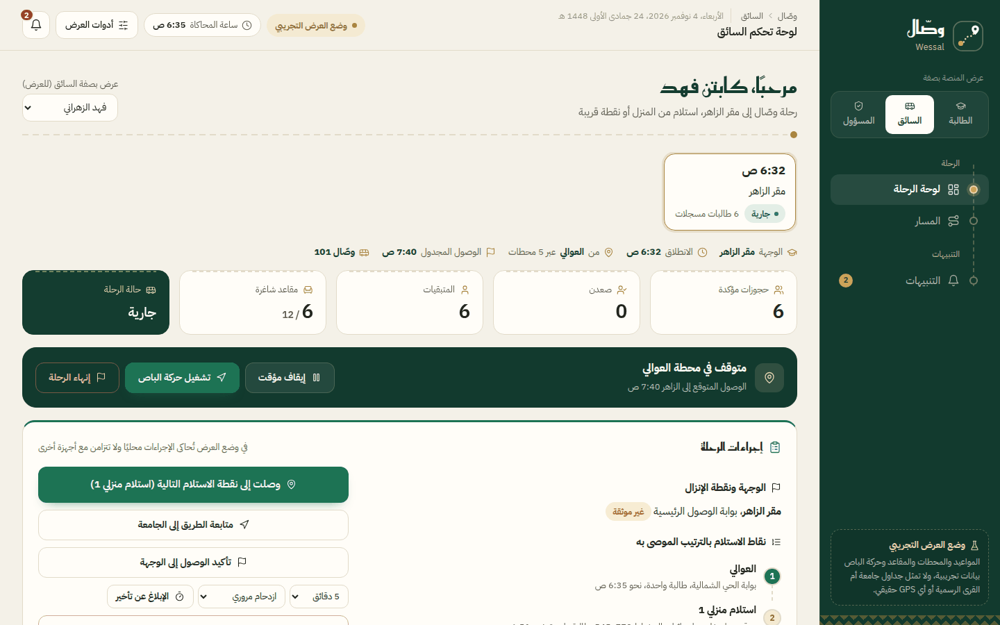

---

## 🤖 AI Dispatch Agent

Groups compatible requests, sequences pickups, selects the best vehicle and explains why — then waits for approval.

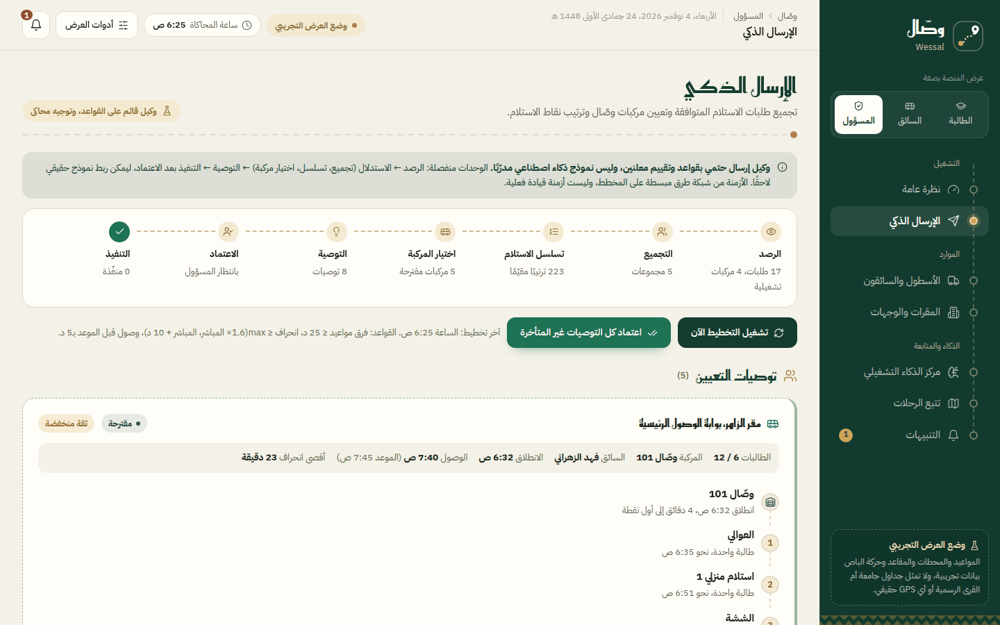

---

## 📊 Admin Overview

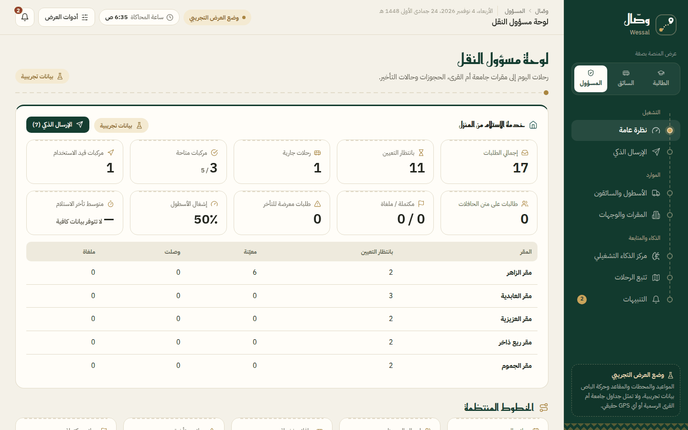

---

## 🚚 Fleet & Drivers

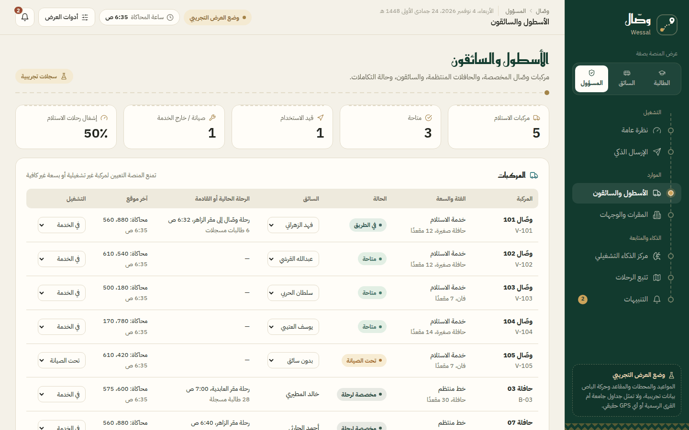

---

## 🏛️ Campuses & Destinations

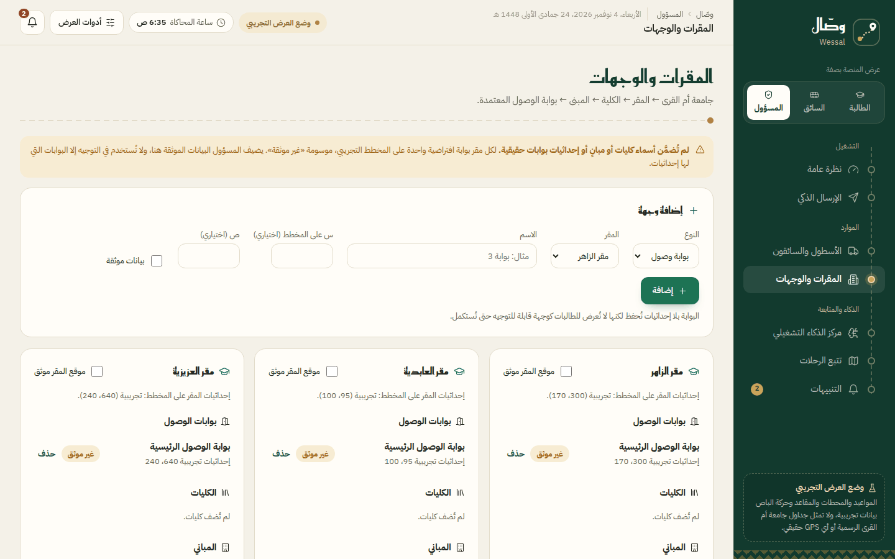

---

## 📈 Demand Forecasting

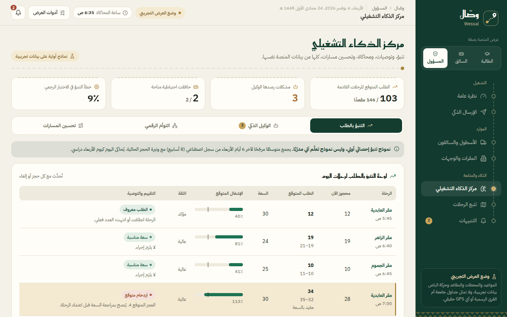

---

## 🧬 Digital Twin & Scenario Simulation

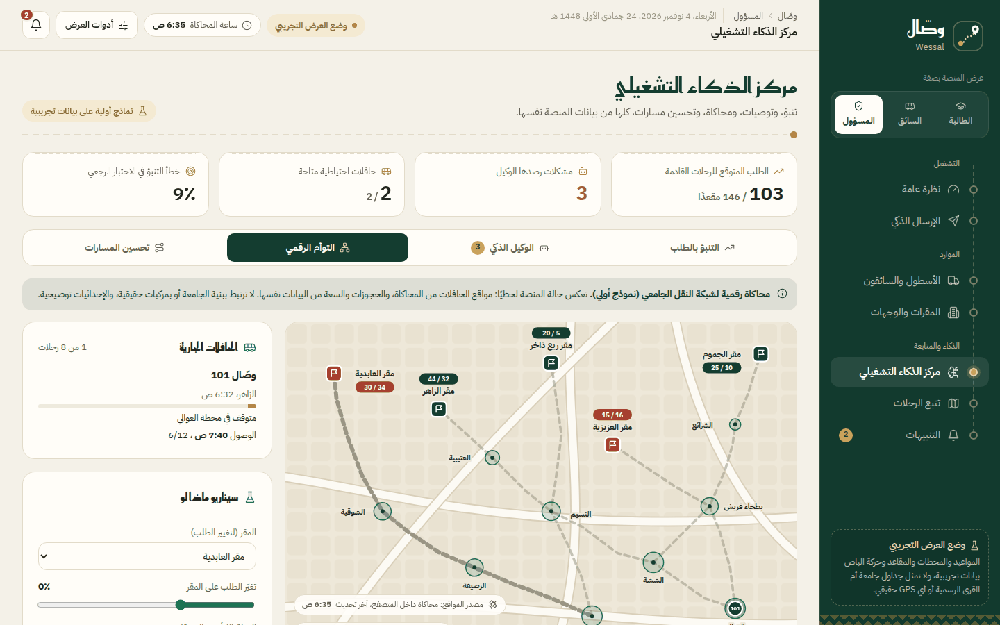

---

## 🛣️ Route Optimization

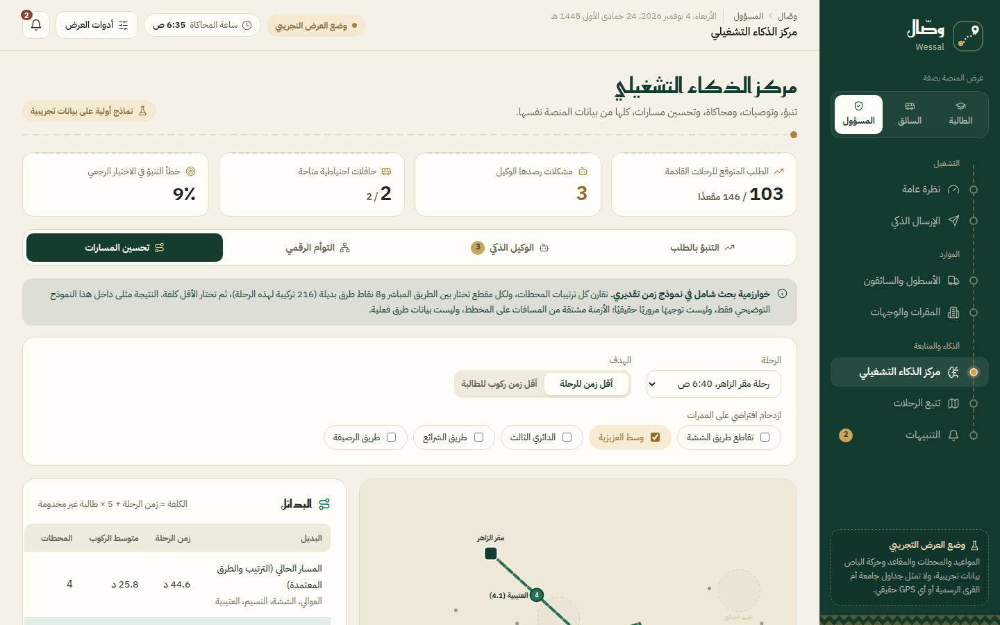

---

## 💬 Smart Assistant

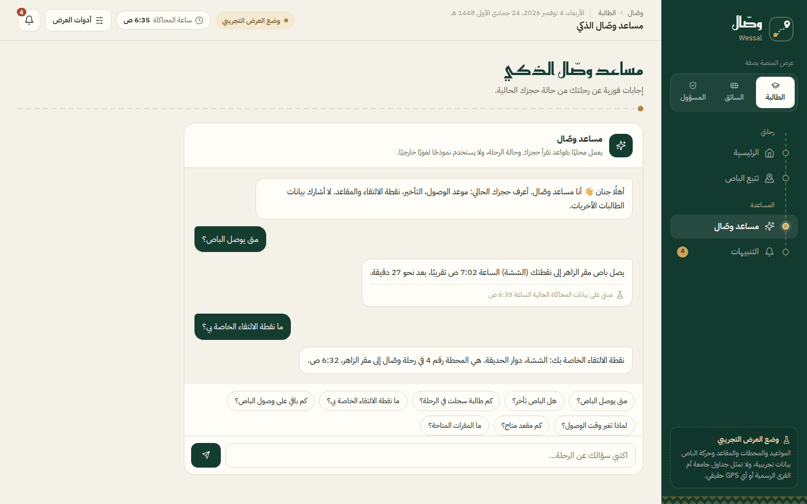

---

## 📱 Mobile View

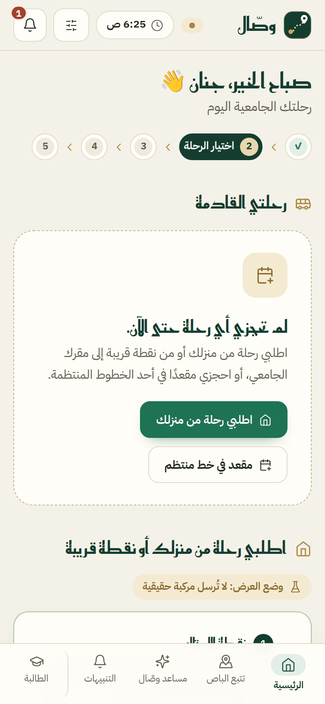

---

# ✨ Features

- 🏠 **Home or nearby pickup** with privacy: the exact home location is shown only to the assigned driver
- 🏛️ **Destination hierarchy**: campus → college → building → approved gate (admin-editable, verified/unverified flags)
- 🤖 **AI dispatch agent**: observe → reason → recommend → approve → execute
  - groups requests by destination gate and arrival time
  - enforces vehicle capacity and a maximum detour per student
  - picks the best available vehicle and driver (no double-booking)
  - flags late-arrival risk, vehicle breakdowns and impossible deadlines
- 🧭 **10-stage request tracking** from *request received* to *student arrived*
- 🔔 **Event-driven alerts**: 5 minutes before arrival, 2 minutes before, and on arrival
- 🚐 **Driver tools**: ordered stops, boarding confirmation, missed-pickup, delay and breakdown reports
- 📈 **Demand forecasting** with an 80% interval and a backtest error metric
- 🧬 **Digital twin**: what-if scenarios (demand surge, road delay, vehicle down, capacity change) — previewed before any real change
- 🛣️ **Route optimization**: exhaustive search over pickup orders and alternative roads
- 🚌 **Scheduled bus lines**: seat booking, cancellation and swapping are still supported
- 🌙 Arabic RTL interface, responsive (desktop / tablet / mobile), light and dark mode

---

# 🛠 Technologies Used

| Category | Technologies |
|---|---|
| Language | JavaScript (ES2020), HTML5, CSS3 |
| Interface | Single-page app, Arabic RTL, responsive CSS design system |
| Agentic AI | Rule-based dispatch agent with transparent scoring and human approval |
| Predictive analytics | Weighted moving average + booking-pace blend, backtested |
| Optimization | Dijkstra shortest paths, exhaustive pickup sequencing, vehicle scoring |
| Digital twin | In-browser simulation of the transport network and scenarios |
| Maps | Custom SVG schematic map (demo, not to scale) |
| IoT / GPS | `WessalVehicleFeed` ingestion interface (ready, no live device connected) |
| Icons & fonts | Lucide icons, IBM Plex Sans Arabic, Reem Kufi |
| Storage | Browser `localStorage` (demo persistence) |

---

# 🔍 How It Works

```
Student request ──► Validation ──► Grouping (same gate + compatible times)
      ──► Pickup sequencing (detour limits) ──► Vehicle & driver selection
      ──► Recommendation with reasons ──► Admin approval ──► Trip created
      ──► Driver executes ──► Live status & alerts for the student
```

### Dispatch rules (prototype)

| Rule | Value |
|---|---|
| Max difference between arrival deadlines in one group | 25 min |
| Max ride time per student | max(1.6 × direct trip, direct + 10 min) |
| Arrival buffer before the earliest deadline | 5 min |
| Vehicle score | 3 × empty seats + minutes to first pickup (+100 if late) |

---

# 🧪 What Is Real vs. Simulated

| Implemented and working in the prototype | Simulated / requires external services |
|---|---|
| Ride requests with validation | Vehicle positions and GPS |
| Grouping, sequencing and vehicle assignment | Road travel times (simplified road network) |
| Approval workflow and decision history | Campus, building and gate coordinates |
| Driver actions and trip status updates | Multi-device sync (needs a backend) |
| Forecasting, digital twin, route optimization | Push notifications (in-app only) |
| Event-driven in-app notifications | Authentication and roles |

The agent and forecasting are **deterministic, rule-based and statistical** — they are not trained machine-learning models.

---

# 🚀 Run Locally

No installation or build step is required.

**Option 1 — open directly**

Double-click `index.html` (or right-click → *Open with* your browser).

**Option 2 — local server (recommended)**

```bash
python -m http.server 8000
```

Then open <http://localhost:8000>.

**Live demo with GitHub Pages**

Repository → *Settings* → *Pages* → *Source: Deploy from a branch* → `main` / `root` → *Save*.
The site will be available at `https://<your-username>.github.io/<repository-name>/`.

> 💡 Use the **أدوات العرض** (Demo Tools) button in the top bar to start trips, jump to the next stop, trigger alerts or reset the demo data.

---

# 🎬 Suggested Demo Flow

1. **Student** → request a ride from الششة to مقر الزاهر, arriving before 7:50
2. **Admin** → *الإرسال الذكي* → review the agent's recommendation → approve
3. **Driver** → start the trip → confirm arrival at each pickup → confirm boarding
4. **Student** → watch the status timeline, tracking map and arrival alerts
5. **Admin** → *مركز الذكاء التشغيلي* → explore forecasting, digital twin and route optimization

---

# 📁 Project Structure

```
Wessal/
├── index.html              # The complete application (HTML + CSS + JavaScript)
├── images/                # Screenshots used in this README
├── docs/
│   └── Wessal-Presentation.pdf   # Final project presentation (Qimma Camp)
├── .gitignore
└── README.md
```

---

# 🔮 Future Development

- 📱 Native mobile apps for students and drivers
- 📡 Real GPS tracking from driver devices
- 🗺️ Real road routing (Google Maps Platform / Mapbox via a backend proxy)
- 🧠 Machine-learning demand models trained on real trip data
- 🗄️ Backend with FastAPI + PostgreSQL/PostGIS, authentication and role-based access
- 🏛️ Verified campus, building and gate data from UQU transport administration

---

# 👩‍💻 Author

**Jenan Hatim Bajawi** — جنان حاتم بجوي

Built for the **Qimma Camp – Emerging Technologies Track** · Tuwaiq Club & Tuwaiq Academy · Umm Al-Qura University

---

> ⚠️ **Disclaimer:** Wessal is an academic prototype. It is not an official Umm Al-Qura University service. All schedules, stops, campus coordinates, vehicles and people shown are fictional demo data.
